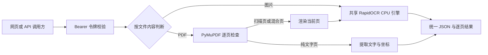

# RapidOCR 图片与 PDF 统一识别服务

简体中文 | [English](README.md)

[源码仓库](https://github.com/DavyDong/RapidOCR-Service) · [AGPL-3.0-only](LICENSE)

一个可以自行部署的文字识别应用：上传图片或 PDF，通过网页或同一个 API 提取文字，支持访问令牌鉴权，并已配好 SAP BTP Cloud Foundry 部署文件。使用 CPU 和共享的 RapidOCR 引擎，无需 GPU 或数据库。

## 项目关系：整合了什么

本项目在 [RapidAI/RapidOCR](https://github.com/RapidAI/RapidOCR) 源码基础上增加 Web/API 服务，参考 [RapidOCRPDF](https://github.com/RapidAI/RapidOCRPDF) 的 PDF 分流思路，实现图片和 PDF 的统一处理。

| 组成 | 在本项目中的作用 |
| --- | --- |
| RapidOCR | 实际使用的 OCR 引擎，直接导入本仓库 `python/rapidocr` |
| RapidOCRPDF | 参考其“原生文字直接提取、扫描页渲染后 OCR”的思路；未直接安装该包或合并其仓库源码 |
| PyMuPDF | 实际负责 PDF 解析、文字提取和页面渲染 |
| FastAPI + 网页 | 新增统一 API、Bearer 鉴权、上传页面、逐页结果与 JSON 下载 |
| BTP 配置 | 新增 Python buildpack 清单、启动命令、健康检查和部署脚本 |

**能力上已经整合成一个应用；实现上是 RapidOCR + PyMuPDF + FastAPI。** 图片和 PDF 共用一个 OCR 引擎，避免重复加载模型。这是基于上游的集成项目，不是 RapidAI 或 SAP 官方发布的产品。

## 功能

- 支持 PNG、JPEG、WebP、BMP、单帧 TIFF 和 PDF，默认识别中英文。
- 纯文字 PDF 页面直接提取；扫描页和含图片的混合页渲染后 OCR。
- 返回全文、实际页数、逐页结果、文字位置和置信度，空白页保留页号。
- 网页提供图片/PDF 示例、页面切换、文字复制、完整 JSON 下载。
- `/api/ocr` 与 `/ocr/invoice` 使用同一处理函数；可选 `force_ocr=true` 强制识别所有 PDF 页面。
- 识别接口必须携带 `Authorization: Bearer <ACCESS_TOKEN>`；服务端未配置令牌时拒绝识别。
- 模型下载和预热后，文件识别在部署机器上执行，不调用第三方云 OCR API。

`/ocr/invoice` 是文字识别入口的别名，目前不推断供应商、税额、发票明细等业务字段。



## 本地快速开始

准备 Python **3.12** 和 [uv](https://docs.astral.sh/uv/)。克隆或下载**包含本集成代码的仓库**，在根目录执行。只克隆 RapidAI 原始仓库不会包含新增的 `deployment/` 服务；首次安装依赖和下载模型需要联网。

```bash
git clone https://github.com/DavyDong/RapidOCR-Service.git
cd RapidOCR-Service
```

Windows / PowerShell：

```powershell
uv venv --python 3.12 .venv
uv pip install --python .venv\Scripts\python.exe -r requirements.txt
.\.venv\Scripts\python.exe -m deployment.engine
$tokenInput = Read-Host '设置 ACCESS_TOKEN' -AsSecureString
$env:ACCESS_TOKEN = [System.Net.NetworkCredential]::new('', $tokenInput).Password
.\scripts\restart-local.ps1
```

打开 [本地网页](http://127.0.0.1:8765) 或 [API 文档](http://127.0.0.1:8765/docs)。网页输入相同令牌；API 文档点击 **Authorize**，只填令牌值，不加 `Bearer` 前缀。

再次运行重启脚本可重启本项目进程，日志位于 `.runtime/`。令牌仅存在于当前页面，不写入浏览器存储；程序不会自动读取 `.env` 文件。Linux/macOS 的 Bash 启动步骤见 [运维指南](deployment/README.md#local-bash)。

## API 调用

| 接口 | 用途 | 鉴权 |
| --- | --- | --- |
| `GET /` | 上传网页 | 公开 |
| `GET /health` | 模型预热完成后的就绪检查 | 公开 |
| `GET /docs` | OpenAPI 交互文档 | 公开 |
| `POST /api/ocr` | 图片或 PDF 识别 | Bearer Token |
| `POST /ocr/invoice` | 与 `/api/ocr` 完全相同 | Bearer Token |

通过 multipart 表单字段 `file` 上传；可选字段 `force_ocr` 默认为 `false`。

```powershell
$baseUrl = 'http://127.0.0.1:8765' # 云端调用时换成自己部署的应用地址。
curl.exe -H "Authorization: Bearer $env:ACCESS_TOKEN" -F "file=@deployment/sample.jpg" "$baseUrl/api/ocr"
curl.exe -H "Authorization: Bearer $env:ACCESS_TOKEN" -F "file=@deployment/sample.pdf" "$baseUrl/ocr/invoice"
# PDF 文字层异常时，可额外添加 -F "force_ocr=true"
```

Bash 使用 `$ACCESS_TOKEN`，PowerShell 使用 `$env:ACCESS_TOKEN`。返回 `type`、`pages`、`text`、`lines`、`page_results` 和 `elapsed_seconds`；每行包含文字、置信度、四点坐标和从 1 开始的页号。原生提取的置信度为 `null`，图片坐标为像素，PDF 为 point（1/72 英寸），以旋转后的可见页面左上角为原点。

完整字段和错误码见 [API 与运维指南](deployment/README.md#api)。BTP 环境变量不会自动同步到调用方电脑，客户端必须使用同一令牌。

## 部署到自己的 SAP BTP

已验证配置：Cloud Foundry、Python 3.12、`python_buildpack`、`cflinuxfs5`、1 个实例、2 GB 内存和 2 GB 磁盘。其他使用者需要自己的 BTP 组织、空间、配额、路由和令牌。

1. 先完成本地依赖安装及模型预热。
2. 将 [manifest.example.yml](manifest.example.yml) 复制为 `manifest.local.yml`，设置自己的应用名。示例采用随机路由，避免占用他人的主机名。
3. 按 [首次部署步骤](deployment/README.md#btp-first-deployment) 登录自己的 CF 环境，用 `--no-start` 创建并上传新应用，在 BTP 配置 `ACCESS_TOKEN` 后启动。

现有 [manifest.yml](manifest.yml) 包含维护者已使用的路由，部署自己的实例应从通用示例开始。后续部署脚本支持 `-AppName`、`-Manifest`，并遮蔽 CF 清单差异输出中可能出现的令牌。`manifest.local.yml`、模型和运行日志已加入 Git 忽略规则。

## 使用限制与验证

| 项目 | 当前限制 |
| --- | --- |
| 单文件大小 | 10 MiB（界面显示 10 MB） |
| 图片像素 | 2400 万；仅单帧 |
| PDF 页数 | 最多 20 页，包含空白页 |
| PDF 渲染 | 目标 200 DPI，每页最多 400 万像素、最长边 3000 像素 |
| PDF 时间预算 | 每页处理前后检查 45 秒预算；当前渲染/OCR 调用不能中断，并非硬超时 |
| 并发 | 每实例同时处理 1 个文件，忙时返回 429 |
| 加密 PDF | 需要密码的文件须先解密 |

上传文件不持久保存；multipart 处理可能使用临时文件，请求结束后关闭。复杂排版、低清晰度和小字可能影响识别效果，业务使用前应核对原文；超长文件请拆分。

2026-10-15 的实现验证通过 **38 项测试**，并完成本地/BTP 图片及双页 PDF 冒烟检查，以及网页页面切换、JSON 下载验证。执行命令见 [验证指南](deployment/README.md#verification)。

## 目录与开源说明

新增服务位于 `deployment/`，其中 `app.py` 提供接口，`documents.py` 处理文件，`engine.py` 预热模型，`static/` 提供网页，`tests/` 提供测试。`scripts/` 包含重启、部署和冒烟检查；`python/rapidocr/` 是实际使用的上游 OCR 源码。

感谢 RapidAI 的 RapidOCR、RapidOCRPDF，以及 PyMuPDF、ONNX Runtime 和 FastAPI 等项目。保留 [RapidOCR Apache-2.0 许可证](LICENSES/Apache-2.0.txt) 与 [模型归属及许可说明](python/MODEL_LICENSES.md)。

**新增集成代码与组合服务采用 [AGPL-3.0-only](LICENSE) 发布**，原始 RapidOCR 源码保留 Apache-2.0 条款。PDF 依赖 PyMuPDF 使用 AGPLv3 或 Artifex 商业许可。本服务完整源码位于 [DavyDong/RapidOCR-Service](https://github.com/DavyDong/RapidOCR-Service)，网页页脚及 API 文档提供源码入口。部署修改版时，需按 AGPL 要求向服务用户提供对应版本的源码；闭源使用需选择合适的商业许可或替换 PDF 实现。

发布自己的版本时，请保留第三方声明，并排除令牌、个人配置、运行日志和真实用户文档。详细来源及许可范围见 [第三方组件说明](THIRD_PARTY_NOTICES.md)。上游自动化文件保存在 `docs/upstream-workflows/`，作为参考文档而非可执行工作流；本仓库暂时关闭 GitHub Actions，待工作流适配本服务后再启用。

<details>
<summary>原始 RapidOCR 库说明（保留上游介绍与归属）</summary>

以下内容描述上游 OCR 库及其多平台能力，不代表新增 Web 服务或完整 PDF 运行时的许可证。

<div align="center">
  <picture>
    <source media="(prefers-color-scheme: dark)" srcset="https://github.com/RapidAI/RapidOCR/releases/download/v1.1.0/Logov2_black.png"  width="60%" height="60%">
    <source media="(prefers-color-scheme: light)" srcset="https://github.com/RapidAI/RapidOCR/releases/download/v1.1.0/Logov2_white.png"  width="60%" height="60%">
    
  </picture>

<div>&nbsp;</div>
<div align="center">
    <b><font size="4"><i>信创级开源OCR - 为世界内容安全贡献力量</i></font></b>
</div>
<div>&nbsp;</div>

<a href="https://clawhub.ai/rapidai/rapidocr" target="_blank"></a>
<a href="https://huggingface.co/spaces/RapidAI/RapidOCRv3" target="_blank"></a>
<a href="https://www.modelscope.cn/studios/RapidAI/RapidOCRv3.0.0/summary" target="_blank"></a>
<a href="https://colab.research.google.com/github/RapidAI/RapidOCR/blob/main/assets/RapidOCRDemo.ipynb" target="_blank"></a>
<a href="">=3.8-aff.svg"></a>
<a href=""></a>
<a href="https://github.com/RapidAI/RapidOCR/graphs/contributors"></a>
<a href="https://pepy.tech/project/rapidocr"></a>
<a href="https://pypi.org/project/rapidocr/"></a>
<a href="https://github.com/RapidAI/RapidOCR/stargazers"></a>
<a href="https://semver.org/"></a>
<a href="https://github.com/psf/black"></a>

简体中文 | [English](./README.md)

</div>

### 📝 简介

RapidOCR 是一款完全开源免费、支持离线快速部署的多平台多语言 OCR 工具，以极致的速度与广泛的兼容性为核心优势。

**支持语言：** 默认支持中英文识别。其他支持的语言，参见文档：[模型列表](https://rapidai.github.io/RapidOCRDocs/main/model_list/)

**项目缘起：** 鉴于 [PaddleOCR](https://github.com/PaddlePaddle/PaddleOCR) 在工程化方面仍有优化空间，为简化并加速 OCR 模型在各类终端设备上的推理部署，我们创新性地将 PaddleOCR 中的模型转换为高度兼容的 ONNX 格式，并基于 Python, C++, Java, C# 等多种编程语言，实现了跨平台的无缝移植，让开发者能够轻松上手、高效集成。

**名称寓意：** RapidOCR 这一名称承载着我们对产品的核心期待——轻快（操作简便、响应迅速）、好省（资源占用低、成本效益高）且智能（依托深度学习技术，实现精准高效的识别）。我们专注于发挥人工智能的优势，打造小巧而强大的模型，始终将速度作为不懈追求，同时确保卓越的识别效果。

**使用指南：**

- **直接部署**：若本仓库提供的模型已满足您的需求，只需参考 [快速开始](https://rapidai.github.io/RapidOCRDocs/main/quickstart/) 即可快速完成 RapidOCR 的部署与使用。
- **定制化微调**：若现有模型无法满足特定场景需求，您可在 PaddleOCR 基础上，利用自有数据进行微调，再将优化后的模型应用于 RapidOCR 的部署流程，实现个性化定制。

如果您觉得本项目对您的工作或学习有所帮助，恳请您不吝赐予一颗 ⭐ Star，给予我们宝贵的支持与鼓励！

### 🎥 效果展示

<div align="center">
    
</div>

### 🛠️ 安装

```bash
pip install rapidocr onnxruntime
```

### 📋 使用

```python
from rapidocr import RapidOCR

engine = RapidOCR()

img_url = "https://www.modelscope.cn/models/RapidAI/RapidOCR/resolve/master/resources/test_files/ch_en_num.jpg"
result = engine(img_url)
print(result)

result.vis("vis_result.jpg")
```

### 📚 文档

完整文档请移步：[docs](https://rapidai.github.io/RapidOCRDocs)

### 👥 谁在使用？([更多](https://github.com/RapidAI/RapidOCR/network/dependents))

- [Docling](https://github.com/DS4SD/docling)
- [CnOCR](https://github.com/breezedeus/CnOCR)
- [api-for-open-llm](https://github.com/xusenlinzy/api-for-open-llm)
- [arknights-mower](https://github.com/ArkMowers/arknights-mower)
- [pensieve](https://github.com/arkohut/pensieve)
- [genshin_artifact_auxiliary](https://github.com/SkeathyTomas/genshin_artifact_auxiliary)
- [ChatLLM](https://github.com/yuanjie-ai/ChatLLM)
- [langchain](https://github.com/langchain-ai/langchain)
- [Langchain-Chatchat](https://github.com/chatchat-space/Langchain-Chatchat)
- [JamAIBase](https://github.com/EmbeddedLLM/JamAIBase)
- [PAI-RAG](https://github.com/aigc-apps/PAI-RAG)
- [ChatAgent_RAG](https://github.com/junyuyang7/ChatAgent_RAG)
- [OpenAdapt](https://github.com/OpenAdaptAI/OpenAdapt)
- [Umi-OCR](https://github.com/hiroi-sora/Umi-OCR)

> 更多使用 RapidOCR 的项目，欢迎在 [登记地址](https://github.com/RapidAI/RapidOCR/discussions/286) 登记，登记仅仅为了产品推广。

### 🙏 致谢

- 非常感谢 [PaddleOCR](https://github.com/PaddlePaddle/PaddleOCR) 的一切。
- 非常感谢 [PaddleOCR2Pytorch](https://github.com/frotms/PaddleOCR2Pytorch) 提供转换后的 PyTorch 格式模型。
- 非常感谢 [PaddleX](https://github.com/PaddlePaddle/PaddleX) 提供文档模型。
- 非常感谢 [DeliciaLaniD](https://github.com/DeliciaLaniD) 修复 ocrweb 中扫描动画起始位置错位问题。
- 非常感谢 [zhsunlight](https://github.com/zhsunlight) 关于参数化调用 GPU 推理的建议以及细致周到的测试。
- 非常感谢 [lzh111222334](https://github.com/lzh111222334) 修复 python 版本下 rec 前处理部分 bug。
- 非常感谢 [AutumnSun1996](https://github.com/AutumnSun1996) 在 [#42](https://github.com/RapidAI/RapidOCR/issues/42) 中的建议。
- 非常感谢 [DeadWood8](https://github.com/DeadWood8) 提供了 [Nuitka 打包 rapidocr_web 的操作文档和可执行 exe](https://rapidai.github.io/RapidOCRDocs/main/install_usage/rapidocr_web/nuitka_package/)。
- 非常感谢 [Loovelj](https://github.com/Loovelj) 指出对文本检测框排序时顺序问题，详情参见 [issue 75](https://github.com/RapidAI/RapidOCR/issues/75)。

### 🤝 贡献指南

本仓库为 RapidOCR 的 **Python** 部分，其他语言已迁移至独立仓库。

参与 Python 开发的完整流程请参阅：[**Python CONTRIBUTING**](docs/CONTRIBUTING-CN.md)。

### 🎖 贡献者

<p align="left">
  <a href="https://github.com/RapidAI/RapidOCR/graphs/contributors">
    
  </a>
</p>

### 🤝 加入我们

请移步：[link](https://rapidai.github.io/RapidOCRDocs/main/communicate/)

### 🌟 赞助商 & 支持者

RapidOCR 是一个基于 Apache2.0 许可的开源项目，其持续开发之所以能够实现，完全得益于这些出色支持者的助力。如果您也想加入他们的行列，不妨考虑 [赞助 RapidOCR](<https://rapidai.github.io/RapidOCRDocs/main/sponsor/>) 的开发。

#### 赞助商

|Sponsors|Application|Introduction|
|:---:|:---:|:---|
||[Quicker](https://getquicker.net/)|您的指尖工作箱|

#### 支持者

<table>
  <tr>
    <td align="center">
      <a href="https://github.com/zg-young">
        
      </a><br />
      <sub><a href="https://github.com/zg-young">@zg-young</a></sub>
    </td>
    <td align="center">
      <a href="https://github.com/Eunsolfs">
        
      </a><br />
      <sub><a href="https://github.com/Eunsolfs">@Eunsolfs</a></sub>
    </td>
    <td align="center">
      <a href="https://github.com/youzzhang">
        
      </a><br />
      <sub><a href="https://github.com/youzzhang">@youzzhang</a></sub>
    </td>
    <td align="center">
      <a href="https://github.com/heyq02">
        
      </a><br />
      <sub><a href="https://github.com/heyq02">@heyq02</a></sub>
    </td>
    <td align="center">
      
      <br />
      <sub>Lucky-Li-le</sub>
    </td>
  </tr>
</table>

### 📜 引用

如果您发现该项目对您的研究有用，请考虑引用：

```bibtex
@misc{RapidOCR 2021,
    title={{Rapid OCR}: OCR Toolbox},
    author={RapidAI Team},
    howpublished = {\url{https://github.com/RapidAI/RapidOCR}},
    year={2021}
}
```

### ⭐️ Star history


### ⚖️ 开源许可证

OCR 模型版权归百度所有，其他工程代码版权归本仓库所有者所有。

该项目采用 [Apache 2.0 license](./LICENSES/Apache-2.0.txt) 开源许可证。

</details>
