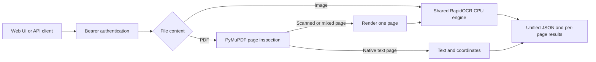

# RapidOCR Image + PDF Service

[简体中文](README-CN.md) | English

[Source repository](https://github.com/DavyDong/RapidOCR-Service) · [AGPL-3.0-only](LICENSE)

A self-hosted web application and FastAPI service for extracting text from images
and PDFs, with Bearer-token authentication and SAP BTP Cloud Foundry deployment
configuration. Runs on CPU with one shared RapidOCR engine.

This integration extends [RapidAI/RapidOCR](https://github.com/RapidAI/RapidOCR).
The implementation is **RapidOCR + PyMuPDF + FastAPI**.
[RapidOCRPDF](https://github.com/RapidAI/RapidOCRPDF) provides the design reference
for native PDF extraction versus page OCR; its package is not installed and the
two upstream repositories have not been merged. The result is one application
and one API contract for both file types. This is not an official RapidAI or SAP release.

## Features

- Images: PNG, JPEG, WebP, BMP and single-frame TIFF; Chinese and English OCR.
- PDFs: native text extraction, scanned/mixed pages, page numbers and text boxes.
- Web UI: upload or try a sample, switch PDF pages, copy text and download JSON.
- API: identical `/api/ocr` and `/ocr/invoice` endpoints; optional `force_ocr=true`.
- Authentication: `Authorization: Bearer <ACCESS_TOKEN>` checked before upload
  parsing; missing server configuration rejects OCR requests.
- BTP: Python buildpack, `$PORT`, `/health`, dependency lock and model warm-up;
  no database or GPU required.

`/ocr/invoice` extracts text and positions; it does not infer structured invoice
fields such as supplier, tax amount or line items.



## Quick start

Use Python **3.12** and [uv](https://docs.astral.sh/uv/). Obtain this integration
repository and run from its root. Cloning only the original RapidAI repository
does not include this integration's `deployment/` files. Initial dependency and
model downloads need internet access; warmed-up inference uses local models.

```bash
git clone https://github.com/DavyDong/RapidOCR-Service.git
cd RapidOCR-Service
```

Windows / PowerShell:

```powershell
uv venv --python 3.12 .venv
uv pip install --python .venv\Scripts\python.exe -r requirements.txt
.\.venv\Scripts\python.exe -m deployment.engine
$tokenInput = Read-Host 'Choose ACCESS_TOKEN' -AsSecureString
$env:ACCESS_TOKEN = [System.Net.NetworkCredential]::new('', $tokenInput).Password
.\scripts\restart-local.ps1
```

Open [the local UI](http://127.0.0.1:8765) or [API docs](http://127.0.0.1:8765/docs).
Use the same token in the page or the docs' **Authorize** dialog. The UI keeps it
only in the current page. The application does not automatically load `.env` files.
See the [operations guide](deployment/README.md#local-bash) for Linux/macOS startup.

```powershell
$baseUrl = 'http://127.0.0.1:8765' # Replace with your own deployed URL when needed.
curl.exe -H "Authorization: Bearer $env:ACCESS_TOKEN" -F "file=@deployment/sample.jpg" "$baseUrl/api/ocr"
curl.exe -H "Authorization: Bearer $env:ACCESS_TOKEN" -F "file=@deployment/sample.pdf" "$baseUrl/ocr/invoice"
```

Bash clients use `$ACCESS_TOKEN` instead of `$env:ACCESS_TOKEN`. Responses contain
`type`, `pages`, combined `text` and `lines`, `page_results` and `elapsed_seconds`.
Lines have 1-based page numbers; native text confidence is `null`. Image boxes use
pixels; PDF boxes use points (1/72 inch) on the rotated visible page. Full fields,
error codes and examples are in the [API guide](deployment/README.md#api).

## Deploy your own SAP BTP instance

Verified configuration: Cloud Foundry, Python 3.12, `python_buildpack`, `cflinuxfs5`,
1 instance, 2 GB memory and 2 GB disk. Users need their own org/space, quota and token.

1. Install dependencies and warm up/download the models as above.
2. Copy [manifest.example.yml](manifest.example.yml) to `manifest.local.yml` and
   choose your application name. A random route avoids hostname conflicts.
3. Follow the [first deployment instructions](deployment/README.md#btp-first-deployment):
   log in, upload the new app with `--no-start`, configure `ACCESS_TOKEN` in BTP,
   and start the app.

The existing [manifest.yml](manifest.yml) targets the maintainer's deployed route;
use the generic example for your own instance. The redeployment script supports
`-AppName` and `-Manifest` and redacts the token from CF manifest-diff output.
Local configuration, models and runtime logs are excluded from Git.

## Limits and validation

- File size: 10 MiB; images: 24 million pixels; PDF: 20 pages, including blank pages.
- PDF rendering: target 200 DPI, at most 4 million pixels and 3000 pixels on the longest side.
- PDF budget: checked before/after each page at 45 seconds; an active OCR/render
  call cannot be interrupted, so this is not a hard request timeout.
- Decrypt password-protected PDFs first; split multi-frame images or convert to PDF.
- One extraction at a time per instance; concurrent extraction returns 429.
- Uploads are not retained; multipart parsing may use temporary files closed after the request.

The 2026-10-15 implementation passed **38 tests**, local/BTP image and two-page PDF
smoke checks, and browser page-switch/JSON-download checks. This is not a guarantee
of OCR accuracy on arbitrary layouts. See [verification commands](deployment/README.md#verification).

## Source and licensing

The added service lives in `deployment/`; `scripts/` contains restart, deployment
and smoke-check helpers. OCR source is in `python/rapidocr/`. `Procfile`,
`runtime.txt`, the manifests and `.cfignore` configure Cloud Foundry deployment.

The added integration and combined service are released under
**[AGPL-3.0-only](LICENSE)**. Upstream RapidOCR retains its
[Apache-2.0 license](LICENSES/Apache-2.0.txt) and [model notices](python/MODEL_LICENSES.md).
**PyMuPDF uses AGPLv3 or an Artifex commercial license**. Source for this service is
available in [this repository](https://github.com/DavyDong/RapidOCR-Service), also
linked from the web footer and API documentation. Operators of modified versions
must provide corresponding source to service users as required by the AGPL.

Read [THIRD_PARTY_NOTICES.md](THIRD_PARTY_NOTICES.md) for provenance and official
license references. Preserve upstream notices and exclude credentials, local
configuration, logs and real user documents from your own releases. The upstream
automation files are retained as documentation in `docs/upstream-workflows/`;
they are not installed as executable workflows. GitHub Actions is disabled until
workflows are adapted for this service.

<details>
<summary>Original RapidOCR library README (upstream scope and attribution)</summary>

The following describes the upstream OCR library and its platforms, not the
added web service or the complete PDF runtime's license.

<div align="center">
  <picture>
    <source media="(prefers-color-scheme: dark)" srcset="https://github.com/RapidAI/RapidOCR/releases/download/v1.1.0/Logov2_black.png"  width="60%" height="60%">
    <source media="(prefers-color-scheme: light)" srcset="https://github.com/RapidAI/RapidOCR/releases/download/v1.1.0/Logov2_white.png"  width="60%" height="60%">
    
  </picture>

<div>&nbsp;</div>
<div align="center">
    <b><font size="4"><i>Open source OCR for the security of the digital world</i></font></b>
</div>
<div>&nbsp;</div>

<a href="https://clawhub.ai/rapidai/rapidocr" target="_blank"></a>
<a href="https://huggingface.co/spaces/RapidAI/RapidOCRv3" target="_blank"></a>
<a href="https://www.modelscope.cn/studios/RapidAI/RapidOCRv3.0.0/summary" target="_blank"></a>
<a href="https://colab.research.google.com/github/RapidAI/RapidOCR/blob/main/assets/RapidOCRDemo.ipynb" target="_blank"></a>
<a href="">=3.8-aff.svg"></a>
<a href=""></a>
<a href="https://github.com/RapidAI/RapidOCR/graphs/contributors"></a>
<a href="https://pepy.tech/project/rapidocr"></a>
<a href="https://pypi.org/project/rapidocr/"></a>
<a href="https://github.com/RapidAI/RapidOCR/stargazers"></a>
<a href="https://semver.org/"></a>
<a href="https://github.com/psf/black"></a>

Join our [Discord](https://discord.gg/33eyQJq498)

[简体中文](./README-CN.md) | English
</div>

### 📝 Introduction

RapidOCR is a completely open-source, free OCR tool that supports multi-platform, multi-language operation and rapid offline deployment. Its core advantages lie in extreme speed and extensive compatibility.

**Supported Languages:** Default support for Chinese and English recognition. For other supported languages, please refer to the documentation: [Model List](https://rapidai.github.io/RapidOCRDocs/main/model_list/).

**Project Origin:** Considering that [PaddleOCR](https://github.com/PaddlePaddle/PaddleOCR) still has room for optimization in engineering aspects, we innovatively converted the models in PaddleOCR into the highly compatible ONNX format to simplify and accelerate the inference deployment of OCR models on various terminal devices. Furthermore, we achieved seamless cross-platform porting based on multiple programming languages such as Python, C++, Java, and C#, enabling developers to get started easily and integrate efficiently.

**Name Implication:** The name "RapidOCR" embodies our core expectations for the product: **Rapid** (simple operation, fast response), **Good & Economical** (low resource consumption, high cost-effectiveness), and **Intelligent** (achieving accurate and efficient recognition relying on deep learning technology). We focus on leveraging the advantages of artificial intelligence to create compact yet powerful models, relentlessly pursuing speed while ensuring excellent recognition results.

**User Guide:**

- **Direct Deployment:** If the models provided in this repository meet your needs, simply refer to the [Official Documentation](https://rapidai.github.io/RapidOCRDocs/main/quickstart/) to quickly complete the deployment and usage of RapidOCR.
- **Custom Fine-tuning:** If the existing models cannot meet specific scenario requirements, you can fine-tune them using your own data based on PaddleOCR, and then apply the optimized models to the RapidOCR deployment process to achieve personalized customization.

If you find this project helpful for your work or study, we kindly ask you to give us a ⭐ Star to provide valuable support and encouragement!

### 🎥 Visualization

<div align="center">
    
</div>

### 🛠️ Installation

```bash
pip install rapidocr onnxruntime
```

### 📋 Usage

```python
from rapidocr import RapidOCR

engine = RapidOCR()

img_url = "https://www.modelscope.cn/models/RapidAI/RapidOCR/resolve/master/resources/test_files/ch_en_num.jpg"
result = engine(img_url)
print(result)

result.vis("vis_result.jpg")
```

### 🐳 Docker

Docker development environments are available for all supported inference engines:

```bash
# Build and test with ONNX Runtime (CPU)
make build-onnxruntime-cpu
make test-onnxruntime-cpu

# Or use any engine: onnxruntime-gpu, tensorrt, paddle, openvino, pytorch, mnn
make build-tensorrt
make shell-tensorrt
```

See [docker/README.md](./docker/README.md) for full setup instructions, GPU configuration, and troubleshooting.

### 📚 Documentation

Full documentation can be found on [docs](https://rapidai.github.io/RapidOCRDocs/), in Chinese.

### 👥 Who use? ([more](https://github.com/RapidAI/RapidOCR/network/dependents))

- [Docling](https://github.com/DS4SD/docling)
- [CnOCR](https://github.com/breezedeus/CnOCR)
- [api-for-open-llm](https://github.com/xusenlinzy/api-for-open-llm)
- [arknights-mower](https://github.com/ArkMowers/arknights-mower)
- [pensieve](https://github.com/arkohut/pensieve)
- [genshin_artifact_auxiliary](https://github.com/SkeathyTomas/genshin_artifact_auxiliary)
- [ChatLLM](https://github.com/yuanjie-ai/ChatLLM)
- [langchain](https://github.com/langchain-ai/langchain)
- [Langchain-Chatchat](https://github.com/chatchat-space/Langchain-Chatchat)
- [JamAIBase](https://github.com/EmbeddedLLM/JamAIBase)
- [PAI-RAG](https://github.com/aigc-apps/PAI-RAG)
- [ChatAgent_RAG](https://github.com/junyuyang7/ChatAgent_RAG)
- [OpenAdapt](https://github.com/OpenAdaptAI/OpenAdapt)
- [Umi-OCR](https://github.com/hiroi-sora/Umi-OCR)

> For more projects that use RapidOCR, you are welcome to [register](https://github.com/RapidAI/RapidOCR/discussions/286) at the registration address. Registration is solely for product promotion.

### 🙏 Acknowledgements

- Many thanks to [PaddleOCR](https://github.com/PaddlePaddle/PaddleOCR) for everything.
- Many thanks to [PaddleOCR2Pytorch](https://github.com/frotms/PaddleOCR2Pytorch) for providing the converted PyTorch format models.
- Many thanks to [PaddleX](https://github.com/PaddlePaddle/PaddleX) for providing the document models.
- Many thanks to [DeliciaLaniD](https://github.com/DeliciaLaniD) for fixing the misplaced start position of scan animation in ocrweb.
- Many thanks to [zhsunlight](https://github.com/zhsunlight) for the suggestion about parameterized call GPU reasoning and the careful and thoughtful testing.
- Many thanks to [lzh111222334](https://github.com/lzh111222334) for fixing some bugs of rec preprocessing under python version.
- Many thanks to [AutumnSun1996](https://github.com/AutumnSun1996) for the suggestion in the [#42](https://github.com/RapidAI/RapidOCR/issues/42).
- Many thanks to [DeadWood8](https://github.com/DeadWood8) for providing the [document](https://rapidai.github.io/RapidOCRDocs/main/install_usage/rapidocr_web/nuitka_package/) which packages rapidocr_web to exe by Nuitka.
- Many thanks to [Loovelj](https://github.com/Loovelj) for fixing the bug of sorting the text boxes. For details see [issue 75](https://github.com/RapidAI/RapidOCR/issues/75).

### 🤝 Contribution Guide

This repository contains the **Python** component of RapidOCR. Components for other languages have been migrated to separate repositories.

For the complete workflow on contributing to Python development, please refer to: [**Python CONTRIBUTING**](docs/CONTRIBUTING.md).

### 🎖 Code Contributors

<p align="left">
  <a href="https://github.com/RapidAI/RapidOCR/graphs/contributors">
    
  </a>
</p>

### 🌟 Sponsors & Backers

RapidOCR is an Apache2.0-licensed open source project with its ongoing development made possible entirely by the support of these awesome backers. If you'd like to join them, please consider [sponsoring RapidOCR's development](https://rapidai.github.io/RapidOCRDocs/main/sponsor/).

#### Sponsors

|Sponsors|Application|Introduction|
|:---:|:---:|:---|
||[Quicker](https://getquicker.net/)|Your fingertip toolbox|

#### Backers

<table>
  <tr>
    <td align="center">
      <a href="https://github.com/zg-young">
        
      </a><br />
      <sub><a href="https://github.com/zg-young">@zg-young</a></sub>
    </td>
    <td align="center">
      <a href="https://github.com/Eunsolfs">
        
      </a><br />
      <sub><a href="https://github.com/Eunsolfs">@Eunsolfs</a></sub>
    </td>
    <td align="center">
      <a href="https://github.com/youzzhang">
        
      </a><br />
      <sub><a href="https://github.com/youzzhang">@youzzhang</a></sub>
    </td>
    <td align="center">
      <a href="https://github.com/heyq02">
        
      </a><br />
      <sub><a href="https://github.com/heyq02">@heyq02</a></sub>
    </td>
    <td align="center">
      
      <br />
      <sub>Lucky-Li-le</sub>
    </td>
  </tr>
</table>

### 📜 Citation

If you find this project useful in your research, please consider cite:

```bibtex
@misc{RapidOCR 2021,
    title={{Rapid OCR}: OCR Toolbox},
    author={RapidAI Team},
    howpublished = {\url{https://github.com/RapidAI/RapidOCR}},
    year={2021}
}
```

### ⭐️ Stargazers over time


### ⚖️ License

License

### Source code

RapidOCR source code and engineering components are copyright
RapidOCR Authors and licensed under the Apache License, Version 2.0.
See [LICENSE](./LICENSES/Apache-2.0.txt).

### Models

The bundled and hosted OCR model files are derived from official
PaddleOCR models. Copyright in the upstream model weights is held by
Baidu and/or the respective PaddleOCR rights holders.

The applicable upstream models are distributed under the Apache
License, Version 2.0. Converted model artifacts, including ONNX
representations produced by RapidOCR, are redistributed under the same
license terms.

RapidOCR does not claim ownership of the upstream model weights.
Model-specific sources, hashes, attribution, and conversion information
are documented in [MODEL_LICENSES.md](./python/MODEL_LICENSES.md).

</details>
